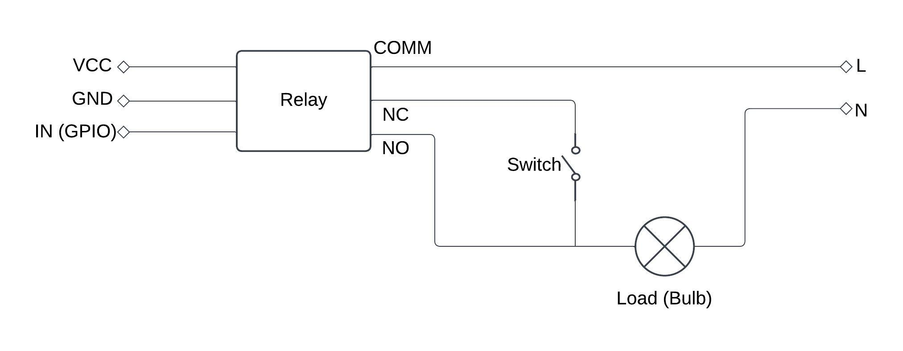

# Control Nest v2

Control Nest is a home automation system for lights, fans, and other relay-connected devices. Use the mobile app to switch devices, set schedules, and manage rooms across your houses. AutoPiHub runs on a Raspberry Pi and controls the GPIO hardware.

This repository contains the mobile app, the hosted website and API, and the Raspberry Pi controller.

[Website](https://controlnest-v2.nmt-solutions.in) | [Setup guide](https://controlnest-v2.nmt-solutions.in/guide) | [Download Android APK](https://github.com/Tauqeer-Ahmed-99/Control-Nest-v2/releases/download/v1.0.0/control-nest-1.0.0-android.apk) | [Releases](https://github.com/Tauqeer-Ahmed-99/Control-Nest-v2/releases)

## How it works

| Component | What it does |
| --- | --- |
| [Mobile app](mobile/README.md) | An Expo and React Native app for controller discovery, device control, schedules, energy summaries, and house members. |
| [Website and API](server/README.md) | A Next.js service for accounts, houses, controller provisioning, and activity records. It uses Clerk, PostgreSQL, Drizzle, and Cloudflare. |
| [AutoPiHub controller](controller/README.md) | A Python FastAPI service that controls Raspberry Pi GPIO, runs schedules, advertises itself on the local network, and connects through Cloudflare Tunnel. |

Each house can have several controllers. Each device belongs to a room and uses a GPIO pin on a specific controller. Members sign in with their own accounts.

## Get started

These steps use the shared Control Nest service operated by NMT Solutions OPC Pvt Ltd.

You need:

- A Raspberry Pi running Raspberry Pi OS, with a suitable power supply and storage.
- A Pi user with `sudo` access, plus `curl` and `tar` installed.
- An Android phone for the published APK.
- Internet access, with the phone and Pi on the same trusted local network during pairing.
- Relay hardware rated for the devices you want to control.

### 1. Install AutoPiHub on your Raspberry Pi

Open a terminal on the Pi or connect over SSH. For a Pi named `rpi`, use:

```bash
ssh your-user@rpi.local
```

Replace `your-user` and `rpi.local` with your Pi's username and hostname. Run the installer as your normal Pi user:

```bash
curl -fsSL https://raw.githubusercontent.com/Tauqeer-Ahmed-99/Control-Nest-v2/main/controller/scripts/install.sh | bash
```

The installer downloads the repository to `~/Control-Nest-v2`, installs the required packages and Python environment, and starts the `autopihub` systemd service. The service starts again when the Pi boots. Git is not required.

The bundled `controller/.env` contains public defaults and update verification keys. See [controller setup](controller/README.md) for configuration details.

### 2. Create a house and controller

1. Register on the [website](https://controlnest-v2.nmt-solutions.in) with your email, first name, and last name. Verify your email.
2. Open **My houses** and create a house.
3. Add a named controller, such as `Ground floor`.
4. Copy its API key. The website shows the full key once.

Create a separate controller entry and key for each Pi. If you lose a key, use **Replace key** on the website and pair that same Pi with the replacement.

### 3. Connect the mobile app

1. Download and install the [Android APK](https://github.com/Tauqeer-Ahmed-99/Control-Nest-v2/releases/download/v1.0.0/control-nest-1.0.0-android.apk).
2. Sign in with the same account and choose your house.
3. Open **Settings > Controllers > Connect a controller**, or **Add > Controller**.
4. Allow local network access and select your Pi under **Nearby controllers**.
5. Paste the controller's API key and tap **Connect controller**, then **Done**.
6. Choose **Open house**. Repeat the connection steps for any additional Pis.

Pairing binds the controller key to this Pi's installation identity and provisions its remote tunnel. The Pi stores the key and tunnel token in protected persistent storage. The app keeps public connection details and clears the key after pairing.

You can also pair from the Pi instead of the app:

```bash
bash ~/Control-Nest-v2/controller/scripts/setup.sh
```

Paste the API key at the hidden prompt. The script stops AutoPiHub during setup and restarts it afterward.

### 4. Add rooms and devices

1. Tap **Add > Room** and name a room.
2. Tap **Add > Device**, enter a device name, and choose its room.
3. Select the controller and an available GPIO header pin. The app uses physical header positions, so check the pin against your wiring.
4. Add a power rating if you want to use energy estimates.
5. Save the device. After the hardware is connected, use its switch in the app to control it.

Open a device's settings to enable a schedule, choose its days, and set its on and off times. The controller runs the schedule. Use the app's activity views to review device changes and **Settings > Request history** to inspect request records.

## Hardware connections

Use the [relay connection diagram](server/public/brand/connection-diagram.jpeg) as a project reference:



The diagram is not a complete electrical installation plan. Never connect mains voltage to Raspberry Pi GPIO. Have a qualified electrician choose the relay ratings and install mains wiring.

## Remote access and data

Cloudflare Tunnel gives each paired controller a public HTTPS hostname without inbound router port forwarding. The controller checks Clerk session tokens and house membership before accepting user requests. Each Pi uses its own revocable API key and installation identity for calls to the hosted API.

The hosted API stores house and device records and activity logs in PostgreSQL. The Pi keeps its installation identity, local configuration, API key, and tunnel token in persistent storage. Preserve that storage across updates and protect it as private device data. Do not copy installation metadata to another Pi.

## Updates and recovery

Enable the protected controller updater once over authenticated SSH from your trusted installation:

```bash
cd ~/Control-Nest-v2/controller
bash scripts/bootstrap.sh
```

Bootstrap installs the update helper and public verification keys, preserves the Pi's identity and data, and moves private deployment settings to root-owned `/etc/control-nest/controller.env`.

A house admin can then open **Settings > Firmware updates** in the app to install an eligible signed controller release. The updater uses a separate application environment, snapshots persistent data, and restores the recorded working release and data if activation fails. Updates continue after the phone disconnects. The old source-overlay updater is disabled. Maintain Raspberry Pi OS separately.

Use **Settings > App updates** to check for compatible mobile updates. Changes to native code require a new app build.

See [OTA operations](docs/ota-operations.md) for deployment, signing keys, backups, and recovery. The [update design](docs/ota-updates-and-recovery.md) documents compatibility rules and recovery behavior. Published downloads and setup notes are on [GitHub Releases](https://github.com/Tauqeer-Ahmed-99/Control-Nest-v2/releases), with a version index in [the release ledger](docs/releases.md).

## Development

Clone the repository, then configure the component you want to run:

```bash
git clone https://github.com/Tauqeer-Ahmed-99/Control-Nest-v2.git
cd Control-Nest-v2
```

### Website and API

Set these variables in a private `server/.env`. The server validates them in [`server/src/env/vars.ts`](server/src/env/vars.ts):

- `DB_ENV`, set to `development` or `production`.
- `NEXT_PUBLIC_CLERK_PUBLISHABLE_KEY` and `CLERK_SECRET_KEY`.
- `DEV_DATABASE_URL` and `PROD_DATABASE_URL`. The configuration requires both.
- `CLOUDFLARE_ACCOUNT_ID`, `CLOUDFLARE_ACCOUNT_API_TOKEN`, and `CLOUDFLARE_ZONE_ID`.
- `WEATHER_API_URL` and `WEATHER_API_KEY`, including in build environments.

Controller updates also need server-side `OTA_JOB_KEY_ID`, `OTA_JOB_PRIVATE_KEY`, and the public verification map `OTA_RELEASE_PUBLIC_KEYS`. Follow the [OTA runbook](docs/ota-operations.md) before enabling updates.

```bash
cd server
npm ci
npm run dev
```

Open `http://localhost:3000`. For a new, empty database, use `npm run db-push` from `server`. For an existing database, follow the [server migration instructions](server/README.md) first. Configure [Clerk email registration](server/README.md#clerk-email-only-registration) for the instance shared by the website and app.

### Mobile app

Configure `EXPO_PUBLIC_SERVER_URL` and `EXPO_PUBLIC_CLERK_PUBLISHABLE_KEY`. OTA policy verification also uses `EXPO_PUBLIC_OTA_POLICY_KEYS`. The linked EAS project is recorded in `mobile/app.json`; any `EXPO_PUBLIC_EAS_PROJECT_ID` override must match it.

Run these commands from the repository root to install dependencies and launch an Android development build:

```bash
cd mobile
npm ci
npm run android
```

Use a connected Android device or emulator with the native build tools installed. See [mobile development](mobile/README.md) for build profiles, API environments, and EAS builds.

### Configuration ownership

Mobile variables prefixed with `EXPO_PUBLIC_` are bundled into the app. Use them only for public values. Keep database credentials, Cloudflare tokens, weather API keys, Clerk secret keys, and update signing keys on the server or in the designated private signing infrastructure.

The controller's public defaults are `SERVER_URL`, `CLERK_JWT_KEY`, `APP_PERSISTENT_STORAGE_PATH`, `OTA_RELEASE_PUBLIC_KEYS`, and `OTA_JOB_PUBLIC_KEYS`. `CLERK_JWT_KEY` is a public PEM verification key. Per-device API keys and tunnel tokens belong in the Pi's protected persistent storage. After bootstrap, private deployment settings belong in `/etc/control-nest/controller.env`.

Existing installations must apply the [controller key migration](server/src/database/migrations/add-controller-api-keys.sql) before using per-controller keys. Keep existing controller IDs, generate keys for those entries, and pair them again on the same Pis. Remove the retired shared credentials `CONTROLLER_USERNAME`, `CONTROLLER_PASSWORD`, `API_USERNAME`, and `API_PASSWORD` from deployment settings.

## Contributing

Fork the repository and create a branch for your change. Follow the relevant component's `AGENTS.md` and nearby implementations. Open a pull request that explains the change and how you checked it. Check the [issues](https://github.com/Tauqeer-Ahmed-99/Control-Nest-v2/issues) for existing reports before opening a new one.
